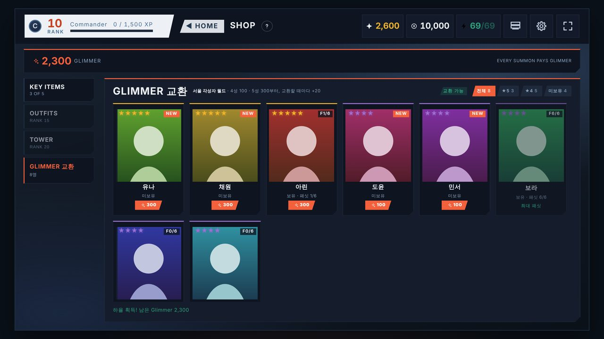
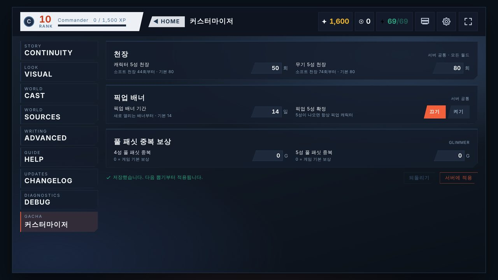
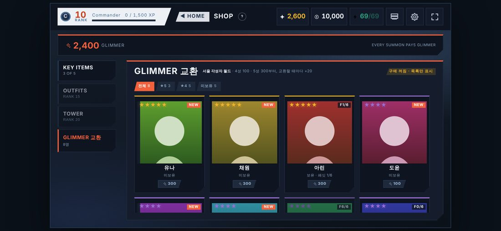

# Gacha Forge Customizer (비공식)

Marinara Engine의 **Gacha Forge 1.8.12**용 비공식 커스터마이저입니다. 게임의 설정 화면과 상점 화면 안에 섹션을 하나씩 추가해서, 천장·픽업·중복 보상을 조절하고 Glimmer로 캐릭터를 교환할 수 있게 합니다.



> 원본 Gacha Forge와 무관한 팬 제작 확장입니다. 원본: [Pasta-Devs/Marinara-Agents · gacha-forge](https://github.com/Pasta-Devs/Marinara-Agents/tree/main/packages/gacha-forge)

## 기능

| 기능 | 내용 |
|---|---|
| 캐릭터 5성 천장 | 1~100회. 소프트 천장은 천장 − 6회부터 자동 적용. 기본 80 |
| 무기 5성 천장 | 1~100회. 기본 80 |
| 픽업 5성 확정 | 켜면 5성이 나올 때 항상 픽업 캐릭터 |
| 픽업 배너 기간 | 1~30일. 새로 열리는 배너부터 적용. 기본 14 |
| 풀 패싯 중복 보상 | 이미 최대 패싯인 4성·5성이 또 나오면 지정한 Glimmer 지급 (예: 4성 120, 5성 600). 0이면 게임 기본(3 / 5) |
| Glimmer 캐릭터 교환 | 4성 100, 5성 300부터. 같은 캐릭터를 교환할 때마다 +20. 최대 패싯·미출시 캐릭터는 구매 불가. 두 번 눌러야 교환 |

- 게임 자체 디자인(버튼·카드·패널)과 HUD 스타일 5종(Vanguard·Aurora·Bloom·Signal·Ember)을 그대로 따라갑니다.
- 가로 화면 전용입니다(게임과 동일). PC와 휴대폰 가로 화면에서 확인했습니다.
- 지금 열린 월드를 게임 통신에서 자동으로 인식합니다. [퀘스트 확장](https://github.com/tlsiddl/Gacha-Forge-Quest-Extension)과 함께 써도 서로 간섭하지 않습니다.

| 설정 화면 | 휴대폰 가로 |
|---|---|
|  |  |

## 구성

두 부분으로 되어 있고, **둘 다** 설치해야 합니다.

1. **개인 확장** (`manifest.json`, `extension.js`): 게임 화면에 섹션을 추가합니다.
2. **서버 패치** (`gf-customizer-runtime.cjs`, `gf-customizer-edits.json`): 서버가 켜질 때 Gacha Forge 서버 코드를 **메모리 안에서만** 고칩니다. 설치된 게임 파일과 세이브는 수정하지 않습니다. 코드가 1.8.12와 정확히 일치하지 않으면 패치는 적용되지 않고 게임은 원래대로 동작합니다.

파일은 모두 [`experimental/live-integration/`](experimental/live-integration)에 있습니다.

## 요구 사항

- Marinara Engine **2.5.0**
- Gacha Forge **1.8.12** (다른 버전이면 서버 패치가 자동으로 꺼집니다)
- Node.js 22.15 이상 (Marinara 공식 Docker 이미지는 Node 24)
- Marinara에서 외부 확장 가져오기 허용

## 설치

### 1. 개인 확장

1. 서버 `.env`에 `ENABLE_EXTERNAL_EXTENSIONS=true`를 넣고 Marinara를 다시 시작합니다.
2. **Settings → Advanced → Danger Zone**에서 **Allow third-party extension imports**를 켭니다.
   휴대폰이나 다른 기기에서 접속한다면 서버의 `ADMIN_SECRET`과 같은 값을 **Settings → Advanced → Admin Access**에 넣어야 합니다.
3. `experimental/live-integration`의 `manifest.json`과 `extension.js` 두 파일을 한 폴더에 넣습니다(또는 그 둘만 ZIP으로 묶습니다).
4. **Settings → Addons → External Extensions → Import Folder**(또는 ZIP)로 가져옵니다.
5. 코드를 확인한 뒤 **Review and Run**으로 켭니다. 이 확장은 게임 화면에 들어가야 해서 **Full page access** 권한을 씁니다.

### 2. 서버 패치 — Docker (확인된 방식)

Marinara의 `docker-compose.yml`이 있는 폴더에서 실행합니다.

```bash
mkdir -p gf-customizer
BASE=https://raw.githubusercontent.com/tlsiddl/gacha-forge-customizer/main/experimental/live-integration
curl -fL "$BASE/gf-customizer-runtime.cjs" -o gf-customizer/gf-customizer-runtime.cjs
curl -fL "$BASE/gf-customizer-edits.json"  -o gf-customizer/gf-customizer-edits.json
curl -fL "$BASE/docker-compose.gf-customizer.example.yml" -o docker-compose.gf-customizer.yml
```

`docker-compose.gf-customizer.yml`을 열어 확인합니다. **이미 `NODE_OPTIONS`를 쓰고 있다면**(다른 패치를 `--require`로 넣고 있다면) 기존 값 끝에 ` --require=/app/gf-customizer-runtime.cjs`를 이어 붙인 값으로 바꿔야 합니다. 그대로 덮어쓰면 기존 패치가 빠집니다.

그다음 기존에 쓰던 Compose 파일 **모두**에 이 파일을 더해서 다시 띄웁니다.

```bash
docker compose -f docker-compose.yml -f docker-compose.gf-customizer.yml up -d --force-recreate
docker compose -f docker-compose.yml -f docker-compose.gf-customizer.yml logs --tail 200 | grep -E "gf-customizer|gacha-forge@"
```

게임을 한 번 연 뒤 다음 두 줄이 보이면 성공입니다.

```
[gf-customizer] applied 14 edits in memory, preserving upstream hook output
Activated and verified capability package gacha-forge@1.8.12
```

`fail closed`가 보이면 Gacha Forge 버전이 다른 것입니다. 패치는 꺼지고 게임은 원래대로 동작합니다.

### 2-1. 서버 패치 — Docker 없이 실행 (확인되지 않음)

`start.bat` / `start.sh`로 실행한다면, Marinara를 시작하는 같은 창에서 환경 변수를 넣고 시작합니다. 경로에 공백이 없는 폴더를 쓰세요.

```bat
:: Windows 예시
set NODE_OPTIONS=--require=C:\gf-customizer\gf-customizer-runtime.cjs
set GF_CUSTOMIZER_EDITS_PATH=C:\gf-customizer\gf-customizer-edits.json
set GF_CUSTOMIZER_CONFIG_FILE=C:\gf-customizer\settings.json
start.bat
```

이 방식은 아직 실제로 해 보지 않았습니다. 해 보신 분은 결과를 알려 주세요.

## 사용법

- **설정**: 게임 설정 → 왼쪽 맨 아래 **커스터마이저**. 값을 바꾸면 **서버에 적용** 버튼이 켜집니다. 저장 즉시 다음 뽑기부터 반영됩니다. 설정은 **서버 전체 공통**이며 월드별로 따로 정할 수 없습니다.
- **교환**: 상점 → 왼쪽 맨 아래 **Glimmer 교환**. ★5 / ★4 / 미보유 필터가 있습니다. 교환 버튼은 한 번 누르면 "한 번 더"로 바뀌고, 4초 안에 다시 누르면 교환됩니다.

## 구매 켜기 / 끄기

구매는 기본으로 **꺼져 있고**, 꺼져 있을 때는 목록과 가격만 보입니다. 켜려면 `docker-compose.gf-customizer.yml`의 다음 값을 `"1"`로 바꾸고 다시 띄웁니다.

```yaml
      GF_CUSTOMIZER_ENABLE_EXCHANGE: "1"
```

켜기 전에 데이터 백업을 권장합니다: `docker cp <컨테이너>:/app/data/. ./backup-data/`

## 업데이트와 제거

- **업데이트**: 같은 파일을 새로 받아 덮어쓰고 다시 띄웁니다. 확장은 같은 이름으로 다시 가져오면 갱신되며, 다시 **Review and Run**이 필요합니다.
- **제거**: 확장을 끄고, Compose 명령에서 `-f docker-compose.gf-customizer.yml`을 빼고 다시 띄웁니다. 게임 파일을 바꾼 적이 없어서 바로 원래 상태가 됩니다. 이미 교환한 캐릭터와 쓴 Glimmer는 세이브에 그대로 남습니다.

## 안전

- 교환 API는 게임의 원래 상점 구매와 같은 Marinara 관리자 인증을 거칩니다.
- 같은 요청이 두 번 들어와도 한 번만 처리되고, 게임 저장과 겹치면 저장하지 않고 다시 시도하게 합니다.
- 서버가 인터넷에 열려 있다면 `ADMIN_SECRET`과 HTTPS(또는 Tailscale 등)는 반드시 설정하세요. 이것은 Marinara 전체에 해당합니다.

검토 근거와 테스트 내용은 [docs/SECURITY.md](docs/SECURITY.md)에 있습니다.

## 알려진 제한

- Gacha Forge **1.8.12 전용**입니다. 게임이 업데이트되면 서버 패치가 꺼지고, 새 버전용 패치가 나올 때까지 기능이 멈춥니다(게임과 데이터는 안전합니다).
- 설정은 서버 전체 공통입니다.
- 배너 기간을 바꾸면 **새로 열리는 배너부터** 적용됩니다. 진행 중인 배너는 원래 기간을 유지합니다.
- 실제 7일 배너 교체와 운영 서버에서의 실제 교환 구매는 아직 장기간 확인되지 않았습니다.

## 테스트

`experimental/live-integration/tests/`

| 테스트 | 내용 |
|---|---|
| `test-extension-jsdom.cjs` | 확장 동작 22항목 (월드 인식·퀘스트 확장 공존·해제/재설치) |
| `test-exchange-isolated.cjs` | 교환 처리 10항목 (모의 저장소) |
| `realtest/test-server.mjs` | **실제 1.8.12 서버 코드**로 교환·목록 13항목 (동시 구매 포함) |
| `realtest/test-summon.mjs` | 실제 소환으로 풀 패싯 보상 확인 |
| `realtest/realgame.mjs` | **실제 게임 클라이언트**를 Chromium에서 띄워 PC·폰 가로 화면 확인 |
| `realtest/themes.mjs` | HUD 스타일 5종 스크린샷 |

실행 방법은 [`realtest/README.md`](experimental/live-integration/tests/realtest/README.md)에 있습니다.

## 변경 기록

[CHANGELOG.md](CHANGELOG.md)
